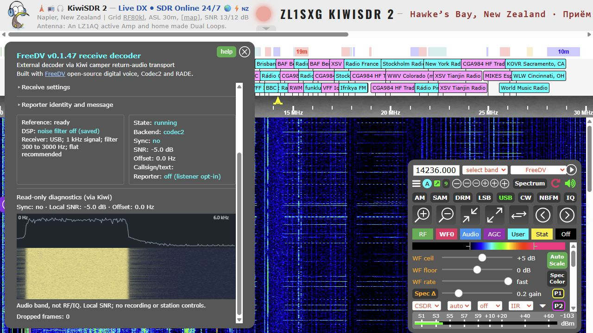

# Read-only diagnostics through the Kiwi proxy

FreeDV extension 0.1.47 and decoder 0.1.41 add an expandable **Read-only diagnostics (via Kiwi)** section to the receiver panel. It works over the normal Kiwi extension WebSocket, including John’s reverse proxy. Start a FreeDV session, then expand the section.

The view shows the current session’s post-detector audio spectrum and waterfall, local modem SNR, sync and frequency offset. This is not the wideband RF waterfall. There are no configuration, service, recording or download controls. The full diagnostics dashboard remains available only on the management LAN.

## Transport and resource boundaries

- The decoder reuses its existing outbound, authenticated Kiwi camper connection; browsers never contact a decoder address.
- No new port, firewall rule, public forwarding or decoder HTTP relay is introduced.
- The existing status stream carries an explicitly constructed four-field spectrum object: version, sequence, sample rate and 256 hex-encoded intensity bins. It contains no identity, Reporter payload, configuration or secrets.
- The FFT worker is shared with the private dashboard. Pairwise peak reduction preserves narrow carriers while reducing bandwidth. Telemetry is latest-only, at most four frames per second for the single supported decode session.
- Optional spectrum data is omitted if it would exceed the existing 2048-byte encoded status ceiling. Failure to acquire the latest-frame lock drops visualization, not modem work.
- The browser validates version, size, rate and intensity range; repeated frames are ignored. Rendering stops when collapsed or the tab is hidden. A fixed 512×200 canvas prevents unbounded history or pixel allocation.
- Relay sequence numbers have a time-seeded origin so decoder-process restarts do not strand a viewer behind its previous frame count. Generation changes also reset the browser trace.
- Older extensions ignore the extra status field; older decoders simply provide no spectrum. Decoder audio continues independently.

This first release visualizes the listener’s active decoder session. It does not provide a separate, cross-session spectator page or grant additional decoder sessions.

After Stop or decoder loss, the last trace remains visible as a reference; it is not a live measurement. The main extension state indicates stopped/offline. A new session clears the trace when its first valid frame arrives.

## Recovery

Use the existing atomic decoder and Kiwi release deployment gates. Keep the previous accepted binary and assets until browser/proxy verification and stability checks pass. No firmware version upgrade is required. Software rollback is not a substitute for a bootable backup microSD.
